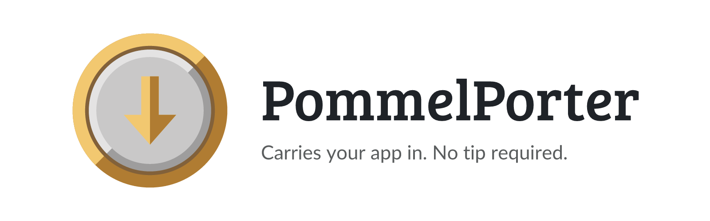
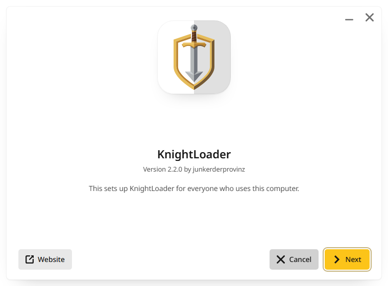
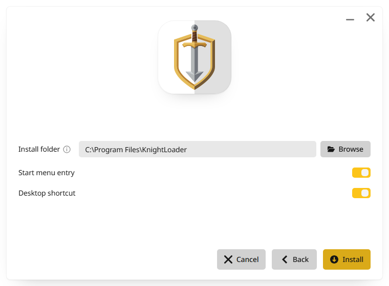
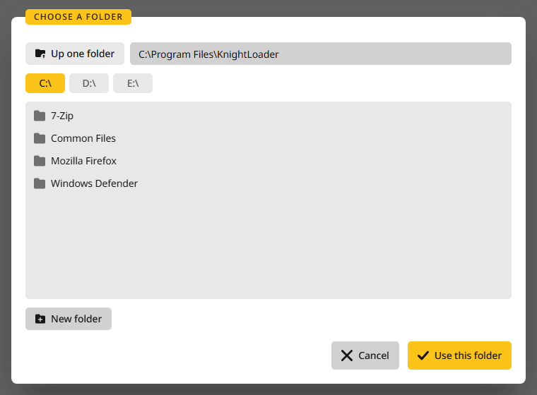
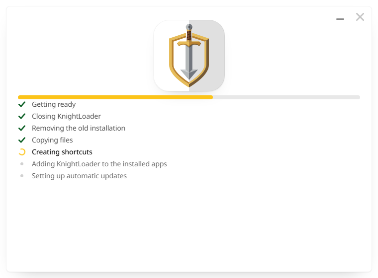
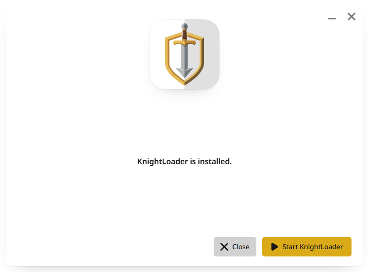
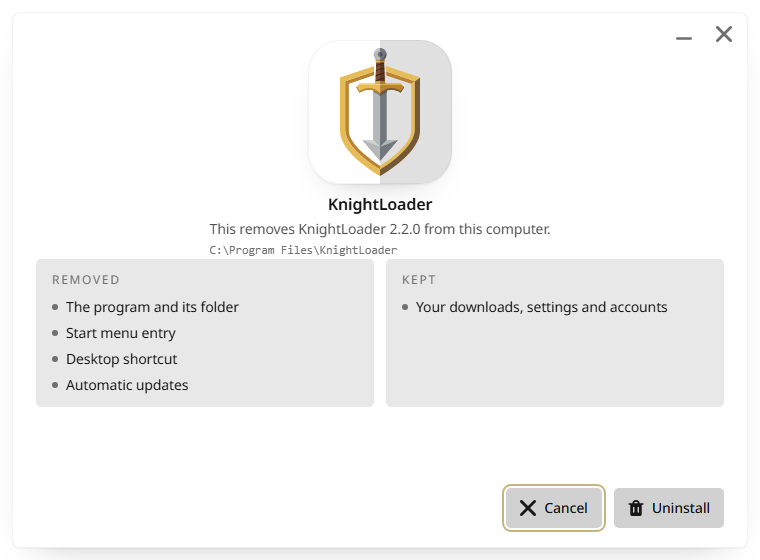

<p align="center">
  <picture>
    <source media="(prefers-color-scheme: dark)" srcset=".github/assets/pommelporter-banner-dark.png">
    
  </picture>
</p>

<p align="center">
  <a href="https://github.com/junkerderprovinz/pommelporter/actions/workflows/ci.yml"></a>&nbsp;
  <a href="https://github.com/junkerderprovinz/pommelporter/actions/workflows/style.yml"></a>&nbsp;
  <a href="https://github.com/junkerderprovinz/pommelporter/releases/latest"></a>&nbsp;
  <a href="https://pkg.go.dev/github.com/junkerderprovinz/pommelporter"></a>&nbsp;
  <a href="https://wails.io"></a>&nbsp;
  <a href="LICENSE"></a>
</p>

<p align="center">
The installer behind <a href="https://github.com/junkerderprovinz/knightloader">KnightLoader</a>, <a href="https://github.com/junkerderprovinz/arrowloop">ArrowLoop</a> and <a href="https://github.com/junkerderprovinz/trickwork">TrickWork</a>.<br>
It installs a <a href="https://wails.io">Wails</a> desktop app on Windows and Linux in a window of its own, in the GlimStone look, and uninstalls it again.
</p>

<br>

<p align="center">
A one-knight job: I build it, keep it running, work through the issues and add what people ask for, until nothing is missing. It is free, with no accounts, no telemetry, no ads and no paid tier. No asterisk anywhere. Nothing readable ever leaves your own walls. Forged on evenings and weekends, with heart and stubbornness.
</p>

<p align="center">
If it has earned a place on your server or computer, toss a coin to your knight: it helps cover the costs and keeps the project alive. It also makes this knight's heart beat a little faster. Three ways below, whichever suits you.
</p>

<br>

<p align="center">
  <a href="https://buymeacoffee.com/junkerderprovinz"></a>
  &nbsp;
  <a href="https://www.paypal.com/donate/?hosted_button_id=76FVV52TKXTUS"></a>
  &nbsp;
  <a href="https://junkerderprovinz.github.io/junkerderprovinz/"></a>
</p>

<br>

## Contents

1. [What it looks like](#1-what-it-looks-like)
2. [What it does](#2-what-it-does)
3. [Using it in an app](#3-using-it-in-an-app)
4. [Building](#4-building)
5. [How AI is used here](#5-how-ai-is-used-here)
6. [Support this project](#6-support-this-project)

<br>

## 1. What it looks like

<p align="center">
  <picture><source media="(prefers-color-scheme: dark)" srcset=".github/assets/screenshots/welcome-dark.png"></picture>
  <picture><source media="(prefers-color-scheme: dark)" srcset=".github/assets/screenshots/options-dark.png"></picture>
  <br><em>The start page shows the app on its tile, the next one asks for the folder and the shortcuts.</em>
</p>

<br>

<p align="center">
  <picture><source media="(prefers-color-scheme: dark)" srcset=".github/assets/screenshots/folder-dark.png"></picture>
  <picture><source media="(prefers-color-scheme: dark)" srcset=".github/assets/screenshots/progress-dark.png"></picture>
  <br><em>The folder picker reaches every drive, and the progress page lists each step as it runs.</em>
</p>

<br>

<p align="center">
  <picture><source media="(prefers-color-scheme: dark)" srcset=".github/assets/screenshots/done-dark.png"></picture>
  <picture><source media="(prefers-color-scheme: dark)" srcset=".github/assets/screenshots/uninstall-dark.png"></picture>
  <br><em>Once it is done, the app can start right away. The uninstaller lists what it removes and what it keeps.</em>
</p>

<br>

## 2. What it does

**On Windows** it installs for everyone on the computer, under `C:\Program Files\<App>` or a folder you pick. It adds a Start menu entry and a desktop shortcut if you want them, an entry under Apps with its uninstaller, and a scheduled task that keeps the app up to date. A copy that is still running is asked to quit first, and installations left by the apps' earlier installers are taken over or removed.

The update task needs a folder nobody else can change. The installer gives the install folder the same rights as Program Files and checks every folder above it. On a drive where everyone may rename what sits at its top, as on many second drives, the task runs as the person who installed instead of as the system account, so swapping the folder gains nothing.

**On Linux** it installs for the current user under `~/.local/share/<app id>`, without a password, and adds a menu entry with the app's icon, a desktop icon if you want one, and an uninstall action in the menu entry.

**macOS** gets a disk image instead of an installer: `cmd/dmgbackground` draws the window background from the app's logo, and `scripts/make-dmg.sh` builds the image around it.

The window speaks the 42 languages the apps do, picked from the system's language, and hands that language to the app for its first start.

<br>

## 3. Using it in an app

An app keeps a small main package next to its desktop module, embeds the built program as its payload, and calls `Run`:

```go
//go:embed payload
var payload embed.FS

func main() {
	files, _ := fs.Sub(payload, "payload")
	err := pommelporter.Run(pommelporter.App{
		Name:       "KnightLoader",
		ID:         "com.junkerderprovinz.knightloader",
		Executable: "KnightLoader.exe",
		Version:    version,
		Publisher:  "junkerderprovinz",
		Homepage:   "https://github.com/junkerderprovinz/knightloader",
		Accent:     "#FCC419",
		Logo:       logo,
		Icon:       icon,
		Payload:    files,
	})
	if err != nil {
		os.Exit(1)
	}
}
```

On Windows the installer needs a manifest that asks for administrator rights, linked in as a `.syso`. KnightLoader's `desktop/installer` and `scripts/desktop.mjs` show the whole build.

The finished installer takes these switches:

| Switch | What it does |
| --- | --- |
| `/S` or `--silent` | Installs without a window, with the last choices or the defaults |
| `/D=<folder>` | The install folder for a silent install on Windows |
| `--uninstall` | Removes the installed copy; the entry under Apps calls the uninstaller this way |

<br>

## 4. Building

The window lives in `ui/` (Vite, React, Tailwind) and is built into `ui/dist`, which is committed and embedded:

```sh
cd ui && npm ci && npm run build
go build ./...
go test ./...
```

`example/` is an installer for a stand-in app; CI uses it to install, check and uninstall for real on Windows and Linux.

<br>

## 5. How AI is used here

One knight builds this, and AI is one of the tools I work with, the same way I work with an editor or a compiler. It helps me write code and documentation and it checks my work, and that saves me a good many evenings. It does not make the decisions, though. I read and understand everything before it ships, and if something here breaks, that is on me and not on the tool.

You do not have to take my word for it. The code is open and every release note is written by hand. The issue tracker shows how problems actually get handled, including the ones I got wrong the first time. If you find something that is not right, open an issue and I will look at it.

<br>

## 6. Support this project

Bugs, ideas or questions? Please [open a GitHub issue](https://github.com/junkerderprovinz/pommelporter/issues).

A one-knight job: I build it, keep it running, work through the issues and add what people ask for, until nothing is missing. It is free, with no accounts, no telemetry, no ads and no paid tier. No asterisk anywhere. Nothing readable ever leaves your own walls. Forged on evenings and weekends, with heart and stubbornness.

If it has earned a place on your server or computer, toss a coin to your knight: it helps cover the costs and keeps the project alive. It also makes this knight's heart beat a little faster. Three ways below, whichever suits you.

<p align="center">
  <a href="https://buymeacoffee.com/junkerderprovinz"></a>
  &nbsp;
  <a href="https://www.paypal.com/donate/?hosted_button_id=76FVV52TKXTUS"></a>
  &nbsp;
  <a href="https://junkerderprovinz.github.io/junkerderprovinz/"></a>
</p>
